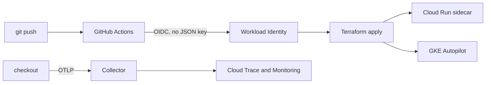

# go-golden-path

Golden path for a Go service. Terraform modules put the same container on Cloud Run or GKE Autopilot, GitHub Actions ships it with Workload Identity Federation, and OpenTelemetry traces leave the process through a collector the platform runs. Dashboards are already in the repo.

The service does not import a GCP exporter. It listens on `PORT` and writes OTLP. Everything else is platform.



## What you can run with no cloud account

```bash
cd service
go test ./...
OTEL_TRACES_EXPORTER=console go run ./cmd/server
```

In another shell:

```bash
curl -s localhost:8080/healthz
curl -s -X POST localhost:8080/v1/orders \
  -H 'content-type: application/json' \
  -d '{"sku":"widget","qty":1}'
curl -s -X POST localhost:8080/v1/orders \
  -H 'content-type: application/json' \
  -H 'X-Demo-Fault: payment' \
  -d '{"sku":"widget","qty":1}'
```

The console exporter prints the trace. `POST /v1/orders` is the server span, `payment.authorize` is the client span underneath it. A sku of `fail` or the header `X-Demo-Fault: payment` declines the charge and marks the span as an error. Probes are not traced.

The full local path adds Jaeger, Prometheus, and a provisioned Grafana dashboard:

```bash
docker compose -f deploy/local/docker-compose.yml up --build
./deploy/local/traffic.sh
```

| Surface | URL |
| :--- | :--- |
| Service | http://localhost:8080 |
| Jaeger | http://localhost:16686 |
| Grafana, dashboard **Checkout RED** | http://localhost:3000 |
| Prometheus | http://localhost:9090 |

Give the rate panels about half a minute. The span-metrics connector flushes every 15 seconds, and `rate()` needs two samples.

## What a deploy looks like

Bootstrap once, from a laptop, with user credentials. That stack enables APIs, creates the Artifact Registry repo, the state bucket, and a Workload Identity Pool that only accepts this repository on `main`. After that, GitHub Actions builds the image and applies the runtime stack. The workflow requests `id-token: write` and nothing else.

[docs/bootstrap.md](docs/bootstrap.md) is the command sequence. [docs/architecture.md](docs/architecture.md) is the reasoning: why the collector is a sidecar with CPU left on, why probes are outside the tracer, why the cluster is a separate apply from the workload.

| Stack | When it runs |
| :--- | :--- |
| `terraform/stacks/bootstrap` | Once, locally. Creates the bucket the other stacks use. |
| `terraform/stacks/cloud-run` | Every push that changes the service, the collector config, or the modules. |
| `terraform/stacks/gke-cluster` | By hand. Autopilot is the expensive object in this repo. |
| `terraform/stacks/gke-workload` | The GKE workflow, after the cluster exists. |

Cloud Run defaults to a private service and deletion protection. The example tfvars flip both for a sandbox. GKE Autopilot is opt-in for the same reason: it is a real cluster, not a sketch.

## Layout

```
service/            reference checkout API, OTLP only
otel/               collector config for GCP and for the local stack
dashboards/grafana  RED dashboard provisioned by compose
terraform/modules   project APIs, registry, GitHub WIF, Cloud Run, Autopilot, workload, monitoring
terraform/stacks    bootstrap, cloud-run, gke-cluster, gke-workload
.github/workflows   test and validate, then the two deploy pipelines
```

The module worth reading first is `terraform/modules/cloud-run-service`. The identity worth reading first is `terraform/modules/github-wif`.

## Service contract

| Method | Path | |
| :--- | :--- | :--- |
| `GET` | `/healthz`, `/readyz` | Probes. Not traced. |
| `POST` | `/v1/orders` | JSON `{"sku","qty"}`. `201` with the order, `502` when payment declines. |
| `GET` | `/v1/orders/{id}` | The order, or `404`. |

Logs are JSON on stdout. When `GOOGLE_CLOUD_PROJECT` is set, each line also carries the Cloud Logging trace field, so a log opens the span.

## CI

Pull requests run `gofmt`, `go vet`, `go test -race`, `terraform fmt -check`, and `terraform validate` on every stack with `-backend=false`. No cloud credentials. The deploy workflows are separate and only run on `main`.
