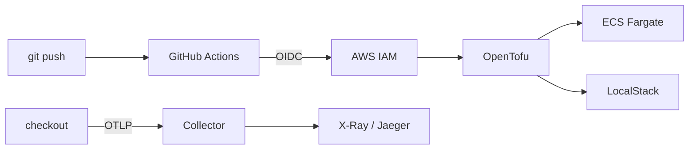

# go-golden-path

Golden path for a Go service, **provider-agnostic at the app boundary**.

The service listens on `PORT` and speaks OTLP. OpenTofu modules deploy the same
Chainguard image to **ECS on LocalStack** or **ECS on AWS**. GitHub Actions
ships it with OIDC. Dashboards are already in the repo.

No HashiCorp Terraform. No Google-only modules. No cloud exporter inside the binary.



## What you can run with no cloud account

```bash
cd service
go test ./...
OTEL_TRACES_EXPORTER=console go run ./cmd/server
```

Full local path (Chainguard app image + LocalStack + Jaeger + Grafana):

```bash
docker compose -f deploy/local/docker-compose.yml up --build
make tofu-local   # optional: apply the ECS stack into LocalStack
./deploy/local/traffic.sh
```

| Surface | URL |
| :--- | :--- |
| Service | http://localhost:8080 |
| LocalStack | http://localhost:4566 |
| Jaeger | http://localhost:16686 |
| Grafana **Checkout RED** | http://localhost:3000 |

## Layout

```
service/                 checkout API, OTLP only, Chainguard Dockerfile
otel/                    collector.local.yaml + collector.aws.yaml
dashboards/grafana       RED dashboard
tofu/modules             network, ecr, ecs_service, state_bucket
tofu/stacks              local (LocalStack), bootstrap, aws
deploy/local             compose + Chainguard collector Dockerfile
.github/workflows        CI (OpenTofu) + Deploy AWS
```

## Stacks

| Stack | When |
| :--- | :--- |
| `tofu/stacks/local` | Laptop → LocalStack. Local state. |
| `tofu/stacks/bootstrap` | Once on real AWS. Creates state bucket, ECR, GitHub OIDC role. |
| `tofu/stacks/aws` | Every push that changes the service or modules. |

## Service contract

| Method | Path | |
| :--- | :--- | :--- |
| `GET` | `/healthz`, `/readyz` | Probes. Not traced. |
| `POST` | `/v1/orders` | `201` or `502` when payment declines. |
| `GET` | `/v1/orders/{id}` | Order or `404`. |

Header `X-Demo-Fault: payment` (or sku `fail`) declines the charge on purpose.

## CI

PRs run `gofmt`, `go vet`, `go test -race`, `tofu fmt -check`, and
`tofu validate` on every stack with `-backend=false`. Deploy is a separate
workflow on `main`.

See [docs/architecture.md](docs/architecture.md) and [docs/bootstrap.md](docs/bootstrap.md).
