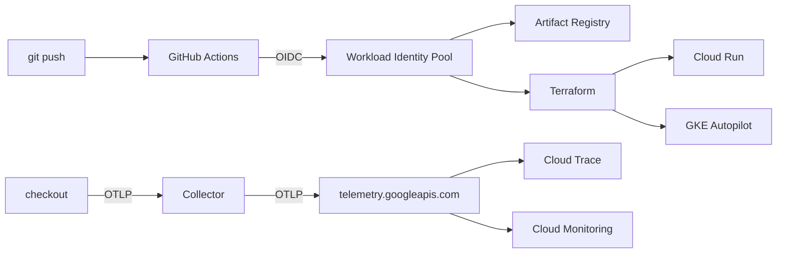

# Architecture

The golden path is a contract between a service and the platform.

The service ships a container that listens on `PORT` and exports OTLP/HTTP. It does not know whether it is on Cloud Run, on GKE, or on a laptop. The platform injects `OTEL_EXPORTER_OTLP_ENDPOINT` and runs the collector next to it.

## Why the app only speaks OTLP

A direct Cloud Trace exporter inside the service would make the binary a GCP client. The next runtime (another cloud, a laptop, a preview environment) would need a code change. The collector is the adapter. Swapping backends is a config change in `otel/`, not a pull request against the service.

On Cloud Run the collector is a sidecar in the same revision, and the app dials `localhost:4318`. On GKE it is a Deployment in `observability`, and the app dials the cluster DNS name. Both use `otel/collector.gcp.yaml`. The local stack uses `otel/collector.local.yaml` and sends traces to Jaeger instead of Google.

The collector's identity is the one that holds `roles/telemetry.writer`. The app's GKE service account has no project roles, and the pod does not mount a token.

## Why Cloud Run keeps the CPU warm for the sidecar

Cloud Run throttles CPU between requests when `cpu_idle` is true. That is the right default for the app container and the wrong one for a collector: the batch export happens after the handler returns, and a throttled sidecar drops it. The module sets `cpu_idle = false` on the collector only. Minimum instances stay at 0, so an idle service still scales to zero.

## Why probes are not traces

`/healthz` and `/readyz` are not wrapped with the OpenTelemetry HTTP handler. A readiness probe every few seconds would become the dominant series on every RED chart. The routes that represent user traffic are wrapped one by one, and the span name is the route template (`POST /v1/orders`), not the request URL. That is what keeps span-metrics cardinality flat.

SKU and order id are span attributes. They are not metric labels.

## What the dashboards actually show

Cloud Run already publishes request rate, latency, and instance count. The Cloud Monitoring dashboard and the two alert policies use those metrics. They work even if the collector is misconfigured, which makes them the right page to open first.

GKE does not have a request metric of its own. The GKE dashboard is container CPU, memory, and restarts. Application RED for that path is the OTLP stream the collector exports, and the same shape is what the Grafana dashboard shows locally from span metrics.

Local Prometheus names, produced by the `span_metrics` connector with namespace `checkout`:

| Signal | Series |
| :--- | :--- |
| Rate and errors | `checkout_calls_total` |
| Latency | `checkout_duration_seconds_bucket` |
| Accepted orders | `orders_created_total` |

## Why CI never sees a key

`terraform/modules/github-wif` creates a Workload Identity Pool whose attribute condition is `assertion.repository == "Riuchek/go-golden-path"` and `assertion.ref == "refs/heads/main"`. The GitHub token is exchanged for a short-lived impersonation of `github-deployer`. The deploy workflows only request `id-token: write`.

The deployer is not an Owner. It has the roles required to apply these stacks, including `roles/resourcemanager.projectIamAdmin`, because the stacks grant roles to runtime service accounts. That binding is the one to revisit if this pattern is copied into a project with more than one team.

Bootstrap state stays on the machine that applied it. The bucket it creates is the backend for every other stack. A stack cannot be the backend of the apply that creates the backend.

## Why the cluster is a separate apply

Creating an Autopilot cluster and deploying a workload in one state forces the Kubernetes provider to configure itself from a cluster that does not exist yet. `gke-cluster` is applied once, by hand, with deletion protection. `gke-workload` only reads the cluster and rolls the Deployment. The workflow that runs on every push is the cheap one.

Autopilot is the cluster module because a platform golden path should not ship node pools, surge upgrades, and a DaemonSet allowlist as the first thing a service team has to understand. A collector Deployment is used instead of a DaemonSet for the same reason: Autopilot restricts DaemonSets, and one collector replica is enough for this service.

## Out of scope

These are real platform problems, and they are not this repository:

- A multi-project landing zone, folders, and org policy.
- Ingress, Cloud Armor, or IAP. The GKE service defaults to ClusterIP.
- A database, migrations, or a real payment provider.
- SLOs beyond the two Cloud Run alerts. The 500ms threshold is a demo line, and the alert text says so.
- Multi-region failover.
