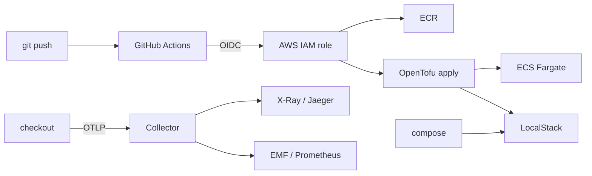

# Architecture

The golden path is a contract between a service and the platform. The service
does not pick a cloud.

The service ships an OCI image that listens on `PORT` and exports OTLP/HTTP.
It never imports a vendor exporter. Local compose, LocalStack, and real AWS
all inject `OTEL_EXPORTER_OTLP_ENDPOINT` and run a collector next to the process.

## Why the app only speaks OTLP

A direct X-Ray or Cloud Trace exporter inside the service would make the binary
a cloud client. The next runtime would need a code change. The collector is the
adapter. Swapping backends is a config change under `otel/`, not a pull request
against the service.

| Surface | Collector config | Backend |
| :--- | :--- | :--- |
| Laptop | `otel/collector.local.yaml` | Jaeger + Prometheus |
| LocalStack / AWS ECS | `otel/collector.aws.yaml` | X-Ray + CloudWatch EMF |

On ECS the collector is a sidecar in the same task and the app dials
`127.0.0.1:4318`. Locally it is a compose service. Both keep the same env vars.

## Why OpenTofu, not HashiCorp Terraform

OpenTofu is the open-source engine this repo commits to. Modules are ordinary
HCL. The AWS provider talks to LocalStack through endpoint overrides in
`tofu/stacks/local`, and to real AWS in `tofu/stacks/aws` with no module fork.

## Why LocalStack

The AWS stack is the production shape. LocalStack is the same shape on a
laptop: S3, ECR, ECS, IAM, logs, X-Ray. `make tofu-local` applies the local
stack against `http://localhost:4566`. No cloud bill to prove the modules.

Chainguard no longer publishes a LocalStack image (the upstream community
edition moved). The compose file uses `localstack/localstack` for the emulator
and Chainguard for the service binary.

## Why Chainguard for the service

`service/Dockerfile` builds with `cgr.dev/chainguard/go` and runs on
`cgr.dev/chainguard/static`. `CGO_ENABLED=0` is required: the static image has
no libc. The collector image stays on `otel/opentelemetry-collector-contrib`
because span-metrics and the AWS exporters live in contrib; Chainguard's
published collector is core-only. `deploy/local/Dockerfile.collector` is the
Chainguard core path when OTLP-in/OTLP-out is enough.

## Why probes are not traces

`/healthz` and `/readyz` are not wrapped with the OpenTelemetry HTTP handler.
A readiness scrape would dominate every RED chart. User routes are wrapped one
by one, and the span name is the route template (`POST /v1/orders`), not the
raw URL. SKU stays on the span, never as a metric label.

## Out of scope

- Multi-account landing zones and org policy
- ALB / CloudFront / WAF in front of the service
- A database or a real payment provider
- Azure / GCP adapters (the contract is ready for them; this repo ships AWS + LocalStack)
